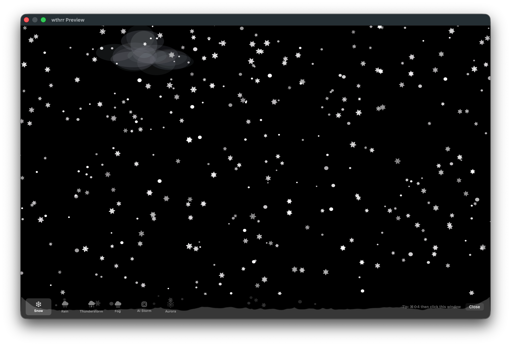
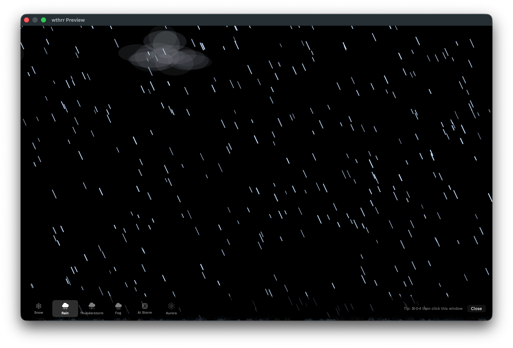
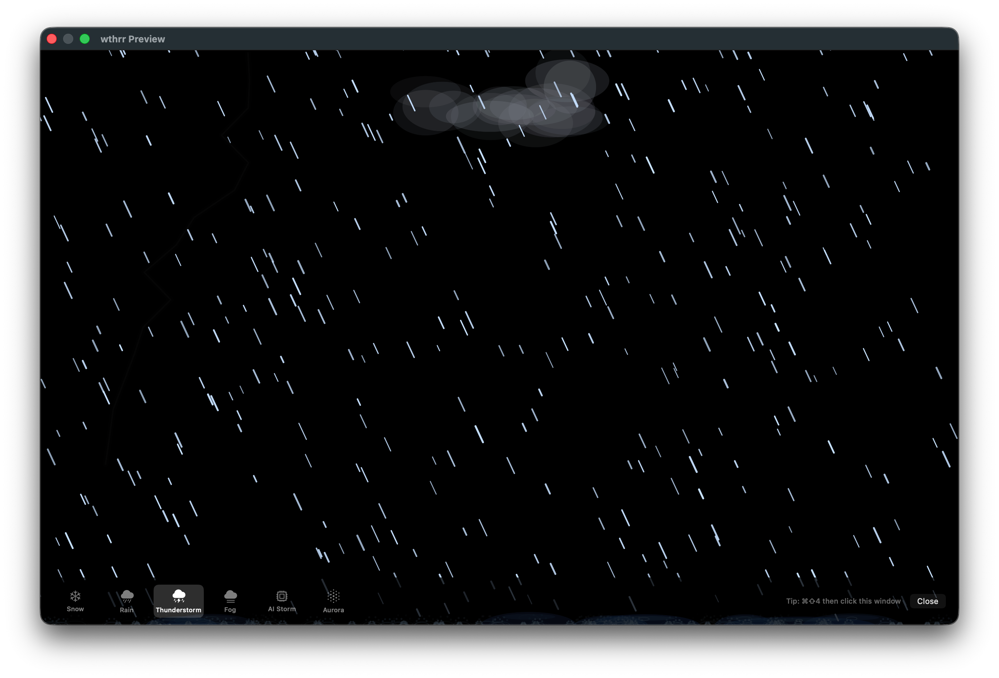
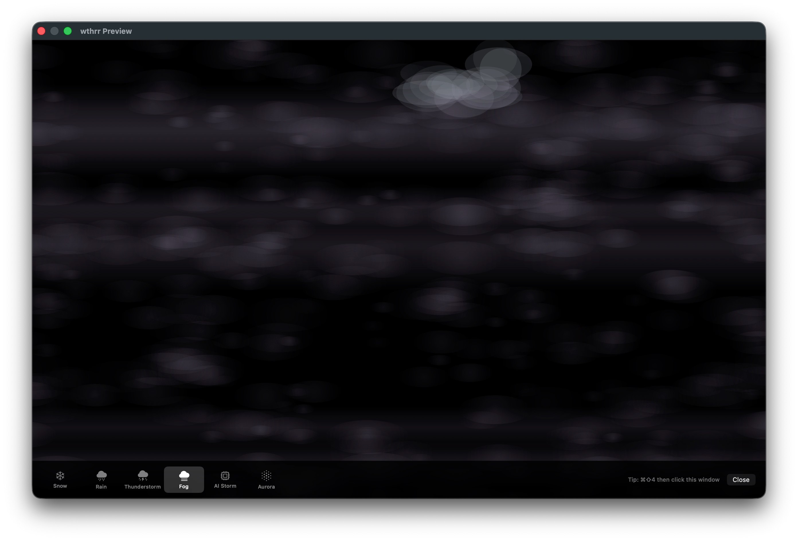
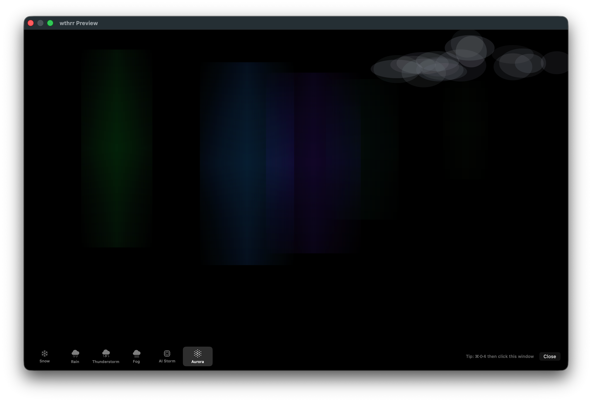

# wthrr

Animated weather effects for your macOS desktop — rendered across all your displays, controlled from the menu bar.

  

---

## Screenshots

<p align="center">
  <a href="images/Snow.png"></a>
  <a href="images/Rain.png"></a>
  <a href="images/Thunderstorm.png"></a>
</p>
<p align="center">
  <a href="images/Fog.jpeg"></a>
  <a href="images/Aurora.png"></a>
  <a href="images/AI%20Storm.png"></a>
</p>

<p align="center">
  <a href="images/Popup%20Menu.jpeg"></a>
  &nbsp;
  <a href="images/Settings%20Appearence.png"></a>
  <a href="images/Settings%20Env.png"></a>
  <a href="images/Settings%20Presets.png"></a>
  <a href="images/Settings%20Behavior.png"></a>
</p>

---

## Install

Download the latest `.dmg` from the [Releases](https://github.com/todddube/wthrr_mac/releases) page, open it, and drag **wthrr** into your Applications folder.

> **Gatekeeper notice:** Because wthrr is distributed outside the App Store without notarization, macOS may block it on first launch. Run this once in Terminal after dragging to Applications:
> ```sh
> xattr -dr com.apple.quarantine /Applications/wthrr.app
> ```
> Then launch normally. You only need to do this once.

---

## Weather Modes

### Snow
Procedural snowfall with three crystal shapes (graupel dots, star plates, branching dendrites) assigned by size. Per-flake rotation, blue tint, and wobble. Drift accumulation with adjustable depth and steady-state melt.

### Rain
Wind-angled streaks, expanding double-ring impact splashes with radiating droplets, and persistent puddles with specular shine and ripple rings.

### Thunderstorm
Heavy rain combined with dark storm clouds, forced lightning strikes, and all intensity knobs turned up.

### Fog
Slow-drifting translucent gradient bands and large soft wisp particles. Beautiful on dark wallpapers with very low performance cost.

### Aurora Borealis
Rippling vertical bands of green, purple, and teal — pure gradient animation, no particle physics needed. Animated silhouette birds drift across the sky, flapping organically. Bird count, size, and wildness (per-bird variation) are all configurable in Appearance settings.

### AI Storm
Neon glitch particles, scan line distortion, circuit-trace data bolts, corruption patches, alien ships with organic steering, and screen fracture crack patterns. 4 swappable color palettes: Cyberpunk, Synthwave, Matrix, Inferno.

---

## Features

### Live Weather
Pulls real conditions from [Open-Meteo](https://open-meteo.com) and auto-applies weather type and intensity. Shows your location name and temperature in the header. Manual controls are disabled while active.

### Presets
9 built-in presets (Blizzard, Light Flurry, Spring Rain, Monsoon, Thunderstorm, Foggy Morning, Aurora Borealis, Glitch Overload, Digital Ghost) plus save/load/delete of custom named presets. Import and export as JSON to share between machines.

### Intensity Quick-Taps
**Light / Medium / Heavy** buttons instantly set amount, speed, wind, and opacity to sensible values. Active level is highlighted; "Custom" appears when you've manually adjusted sliders.

### Pause & Global Hotkey
Pause/Resume button freezes all effects instantly. Customizable global hotkey (default: **Cmd+Shift+P**) works even when the app isn't focused. Menu bar icon reflects paused state.

### Color Theming
Snow, Rain, and Fog each have a hue slider with live preview. AI Storm has 4 named neon palettes. Colors update in real time.

### Multi-Display Support
Overlays span all connected displays, or pick specific monitors. Windows rebuild automatically when displays are added or removed.

### Behavior
- **Launch at Login** — start wthrr automatically when you log in
- **Seasonal auto-switch** — Snow in winter, Rain in spring, Thunderstorm in summer, Fog in autumn
- **Night dimming** — subtly dims effects between 10 pm–5 am with dusk/dawn transitions
- **Low Power Mode** — limits animation to ~30 fps

### Screenshot Preview
Right-click the menu bar icon → **Screenshot Preview…** to open a clean 1280×800 window with a solid black background. Switch between all six effects without leaving the window. Use **⌘⇧4** then click to capture frameable screenshots of any effect.

---

## Settings

A compact **menu bar popover** gives you everyday controls — weather type picker, intensity quick-taps, live weather toggle, display selection, and pause. The full **Settings window** (System Preferences-style icon toolbar) has a persistent **weather type picker** at the top so you can switch modes without leaving the window — controls update instantly to show options relevant to that type. Four tabs:

| Tab | Controls |
|-----|----------|
| **Appearance** | Particle amount, speed, opacity; per-weather colour controls; snow melt rate; AI Storm density; aurora bird count, size, and wildness |
| **Environment** | Wind strength/direction/angle; cloud size, speed, opacity; drift accumulation depth; lightning frequency |
| **Presets** | Built-in + user presets; save, delete, import/export JSON |
| **Behavior** | Launch at Login, Seasonal auto-switch, Night Dimming, Low Power Mode; Onboarding and What's New |

---

## Building from Source

**Requirements:** macOS 26.4+, Xcode 26+

```bash
git clone https://github.com/todddube/wthrr_mac.git
cd wthrr_mac
open wthrr.xcodeproj
```

Select the **wthrr** scheme, choose **My Mac**, and hit **Cmd+R**. The app appears as a weather icon in your menu bar.

---

## Architecture

```
wthrr/
├── App/            Entry point, AppDelegate, lifecycle, global hotkey
├── Models/         WeatherSettings, Particle, ScreenGeometry, WeatherPreset,
│                   HotkeyBinding, ColorTheme
├── Snow/           SnowParticle (shapes + factory), SnowRenderer
├── Rain/           RainParticle (splash/puddle + factory), RainRenderer
├── AIStorm/        AIStormParticle (glitch types + factory), AIStormRenderer
├── Fog/            FogParticle (bands + factory), FogRenderer
├── Aurora/         AuroraParticle (factory), AuroraRenderer
├── Clouds/         Cloud (factory), CloudRenderer
├── Animation/      WeatherAnimationModel — display-synced physics engine
├── Views/          WeatherView, ContentView, SettingsWindowView, SplashView,
│                   OnboardingView, WhatsNewView, WeatherPreviewView
├── Windows/        OverlayWindowController — per-display overlay windows
└── Assets.xcassets
```

`WeatherSettings.shared` is the `@Observable` singleton that drives everything. All settings persist to `UserDefaults` via `didSet`. Each display gets its own borderless, transparent, click-through `NSWindow` managed by `OverlayWindowController`. Particle physics run in `WeatherAnimationModel`, driven by `TimelineView(.animation)` synced to the display refresh rate.

---

## Releasing

See [RELEASE.md](RELEASE.md) for the full release process — version bumping, DMG build, tagging, and publishing to GitHub Releases.

## Roadmap

See [FUTURE.md](FUTURE.md) for planned features and ideas.

---

## Author

**Todd Dube** — [github.com/todddube](https://github.com/todddube)

## License

MIT — see [LICENSE](LICENSE) for details.
